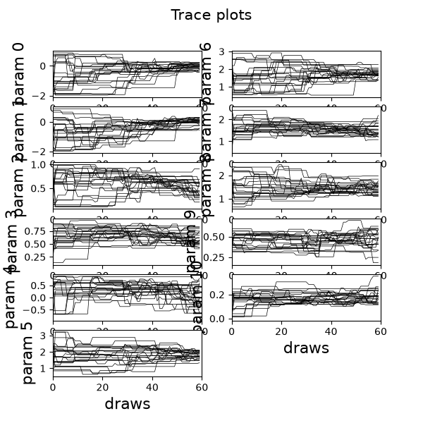
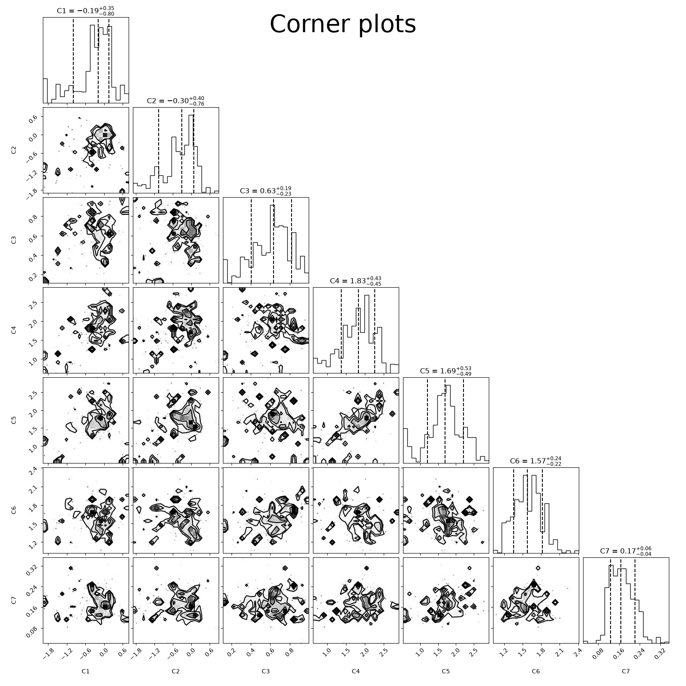
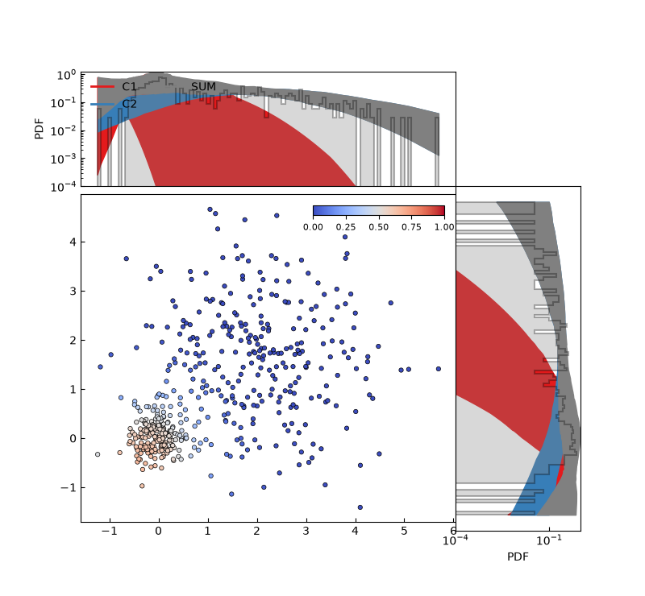

Kinematic Proper Motion Mixture Modeling
========================================

This tutorial demonstrates how to model astronomical proper motion distributions with **MGCS_pytools**, fitting a mixture of bivariate Gaussians convolved with measurement errors using Markov Chain Monte Carlo (MCMC).

Background
----------
In globular cluster studies, distinguishing cluster member stars from Galactic field star contamination is fundamental. Because cluster stars share a common Galactic orbit, their proper motions cluster tightly in the Vector Point Diagram (VPD) :math:`(\mu_\alpha \cos\delta, \mu_\delta)`, whereas field stars exhibit a broader distribution.

Each observed star :math:`i` has proper motion :math:`(x_{1,i}, x_{2,i})` and measurement errors :math:`(\sigma_{x_1,i}, \sigma_{x_2,i})`. The observed distribution is modeled as a convolution of the intrinsic Gaussian components with per-star error ellipses.

Workflow Overview
-----------------

1. Data Preparation
^^^^^^^^^^^^^^^^^^^
The input data must be structured as an :math:`(N, 4)` array:

.. code-block:: python

   import numpy as np
   from mgcs_pytools.mcmc import MCMCEnsembleSampler, get_component_membership_from_mcmc_chain
   from mgcs_pytools.utils import plotting as utplot

   # Simulated Cluster (N=200) + Field (N=300)
   pm_ra_cluster = np.random.normal(0.0, 0.3, 200)
   pm_dec_cluster = np.random.normal(0.0, 0.3, 200)
   pm_ra_field = np.random.normal(2.0, 1.2, 300)
   pm_dec_field = np.random.normal(1.5, 1.2, 300)

   pm_ra = np.concatenate([pm_ra_cluster, pm_ra_field])
   pm_dec = np.concatenate([pm_dec_cluster, pm_dec_field])
   epm_ra = np.random.uniform(0.08, 0.12, len(pm_ra))
   epm_dec = np.random.uniform(0.08, 0.12, len(pm_dec))

   data = np.column_stack([pm_ra, pm_dec, epm_ra, epm_dec])

2. MCMC Prior Bounds & Initialization
^^^^^^^^^^^^^^^^^^^^^^^^^^^^^^^^^^^^^
For :math:`K=2` components with 5 parameters each :math:`(\mu_1, \mu_2, \sigma_1, \sigma_2, \rho)` plus :math:`K-1=1` mixture weight, the parameter vector has length 11:

.. code-block:: python

   qmin = np.array([-2.0, -2.0, 0.1, 0.1, -0.9,  0.5, 0.5, 0.5, 0.5, -0.9, 0.1])
   qmax = np.array([ 1.0,  1.0, 1.0, 1.0,  0.9,  3.5, 3.0, 2.5, 2.5,  0.9, 0.8])

   sampler = MCMCEnsembleSampler(
       data=data,
       nwalkers=32,
       nsteps=500,
       ncomp=2,
       par_per_comp=5,
       qmin=qmin,
       qmax=qmax,
       pmodel="bivariate_normal",
   )
   sampler.run_emcee()

3. Inspecting Chains & Convergence
^^^^^^^^^^^^^^^^^^^^^^^^^^^^^^^^^^
Examine walker trace plots and the posterior parameter correlations:

.. code-block:: python

   chain = sampler.get_chain()
   fig_traces = utplot.traceplots(chain, burnin=100, title="Walker Traces")

Corner Plot:

.. code-block:: python

   flat_chain = sampler.get_chain(discard=100, flat=True)
   fig_corner = utplot.plot_corner(flat_chain, title="Parameter Posteriors")

4. Membership Extraction & Vector Point Diagram
^^^^^^^^^^^^^^^^^^^^^^^^^^^^^^^^^^^^^^^^^^^^^^^
Compute per-star cluster membership probabilities using the converged chain:

.. code-block:: python

   # Extract membership for component 1 (cluster)
   memberships = get_component_membership_from_mcmc_chain(
       flat_chain, data, ncomp=2, par_per_comp=5
   )
   cluster_membership = memberships[0]

   # Plot Vector Point Diagram with marginal distributions
   fig_vpd = utplot.plot_vpd_and_mdist_component(
       mux=pm_ra,
       muy=pm_dec,
       ch=flat_chain,
       membership=cluster_membership,
       ncomp=2,
       par_per_comp=5,
       xerror=epm_ra,
       yerror=epm_dec,
       vpd_xlabel=r"$\mu_\alpha \cos\delta$ [mas yr$^{-1}$]",
       vpd_ylabel=r"$\mu_\delta$ [mas yr$^{-1}$]",
   )

