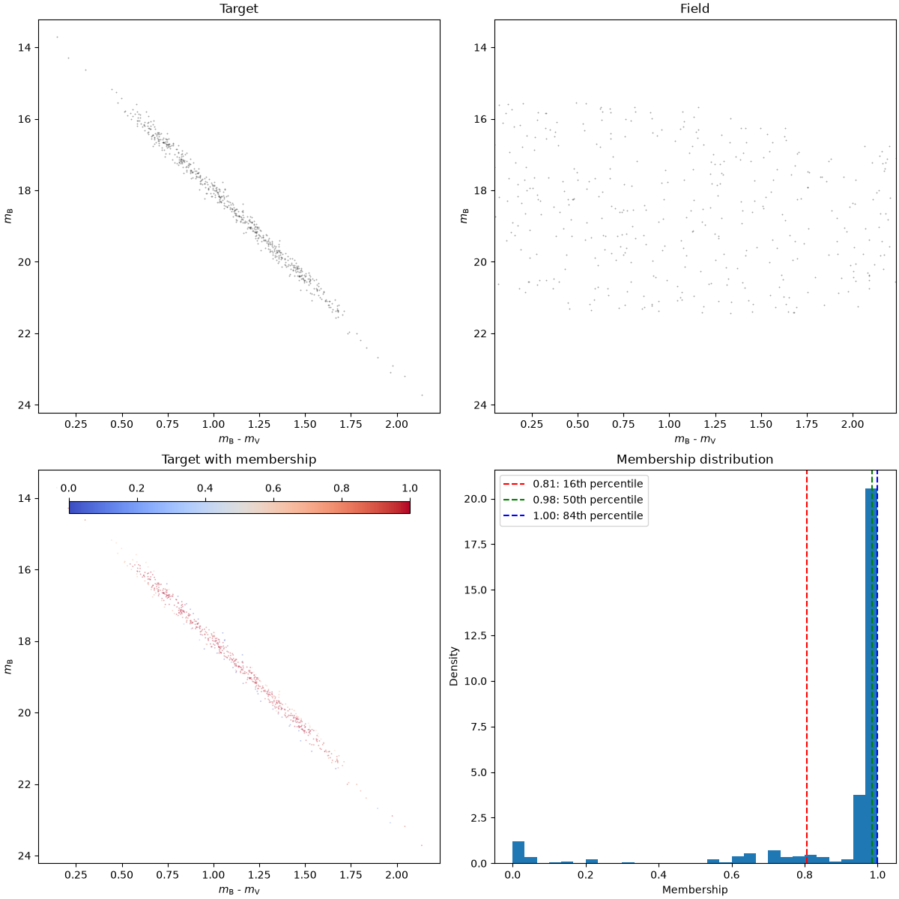
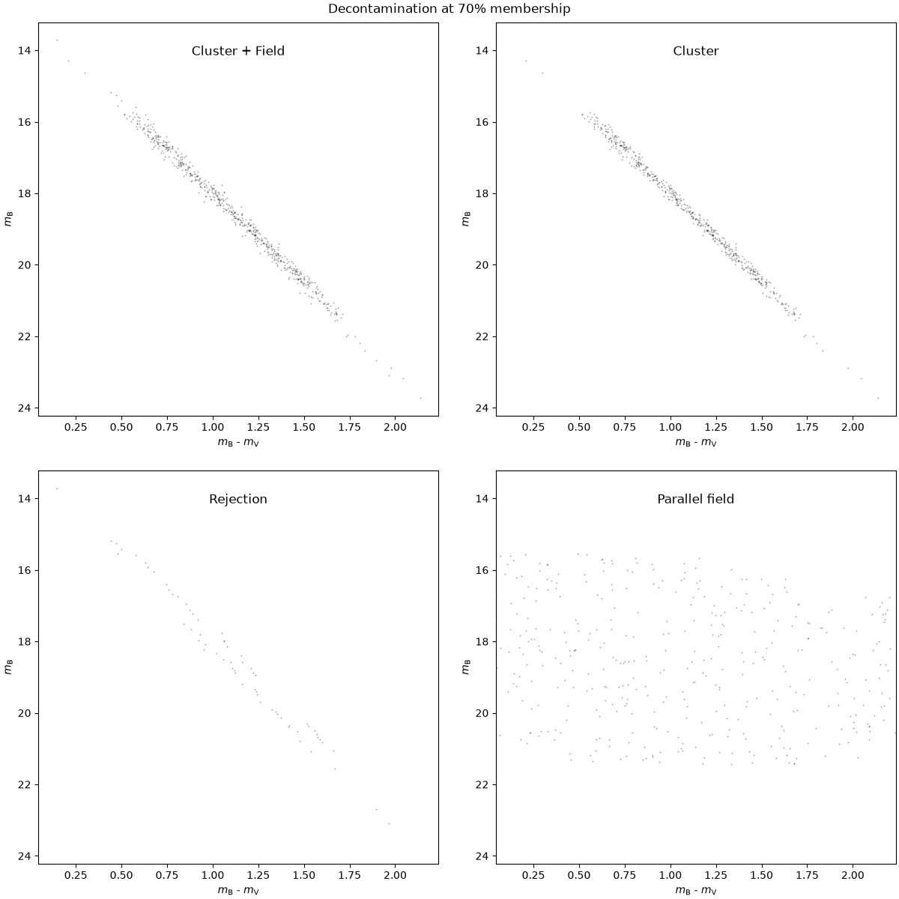

Photometric Membership & Differential Reddening
===============================================

This tutorial explains the photometric decontamination workflow combining adaptive Centroidal Voronoi Tessellations (CVT) and differential reddening correction.

Methodological Background
--------------------------
In dense stellar fields or toward the Galactic bulge, interstellar dust produces spatial variations in extinction across the cluster field of view, known as **differential reddening** (:math:`\Delta E(B-V)`). This broadens evolutionary sequences on the Color-Magnitude Diagram (CMD), hindering proper membership identification.

**MGCS_pytools** solves this through an integrated, iterative procedure:

1. **Spatial Grouping**: Stars in the cluster catalog are partitioned into concentric annuli whose areas are scaled to match field star counts (:func:`~mgcs_pytools.statistical_membership.spatial_groupby`).
2. **Differential Reddening Evaluation**: The CMD is rotated to align with the reddening vector. A fiducial main sequence line is fitted, and spatial variations in color excess :math:`\Delta E(B-V)` are derived via nearest reference stars (:func:`~mgcs_pytools.statistical_membership.compute_differential_reddening`).
3. **Adaptive Voronoi Decontamination**: An adaptive Centroidal Voronoi Tessellation (:class:`~mgcs_pytools.statistical_membership.CVTGrid`) partitions the CMD into cells with uniform star counts. The expected field star density from an offset parallel field is subtracted from each cell (:func:`~mgcs_pytools.statistical_membership.get_membership`).

Running Decontamination
-----------------------

.. code-block:: python

   import pandas as pd
   from mgcs_pytools.statistical_membership import compute_statistical_membership
   from mgcs_pytools.utils import plotting as utplot

   # Define parameters for differential reddening
   dr_params = {
       "rband1": 0.96,        # A(lambda)/A(V) ratio for band 1
       "rband2": 0.72,        # A(lambda)/A(V) ratio for band 2
       "TO_mag": 19.5,        # Turn-off magnitude
       "TO_color": 0.85,      # Turn-off color
       "nref": 50,            # Number of nearest reference stars
       "ord_step": 0.1,       # Ordinate bin step
   }

   # Execute the iterative decontamination
   df_corrected = compute_statistical_membership(
       df_cluster=df_cluster,
       df_field=df_field,
       target_mag_col=["F606W", "F814W"],
       target_mag_col_error=["F606W_err", "F814W_err"],
       field_mag_col=["F606W", "F814W"],
       dr_params=dr_params,
       parallel_fov=0.012,    # Parallel field area in deg^2
       member_threshold=0.8,
       membership_method="analytical",
   )

Visualizing Membership Overview
-------------------------------
The 4-panel membership overview compares the target CMD, parallel field CMD, membership probabilities, and the probability distribution:

.. code-block:: python

   fig = utplot.plot_membership_overview(
       btarget=df_corrected["F606W_drcorr"].values,
       vtarget=df_corrected["F814W_drcorr"].values,
       bfield=df_field["F606W"].values,
       vfield=df_field["F814W"].values,
       membership=df_corrected["membership"].values,
       blabel=r"$m_{\mathrm{F606W}}$",
       vlabel=r"$m_{\mathrm{F814W}}$",
   )

Decontamination Snapshot
------------------------
Compare the raw observed CMD with the decontaminated cluster sequences and rejected field stars:

.. code-block:: python

   fig = utplot.plot_decontamination_snapshot(
       btarget=df_corrected["F606W"].values,
       vtarget=df_corrected["F814W"].values,
       bfield=df_field["F606W"].values,
       vfield=df_field["F814W"].values,
       membership=df_corrected["membership"].values,
       member_threshold=0.8,
       blabel=r"$m_{\mathrm{F606W}}$",
       vlabel=r"$m_{\mathrm{F814W}}$",
   )

